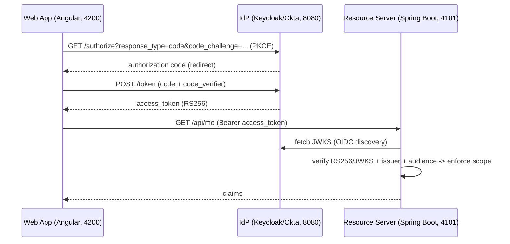
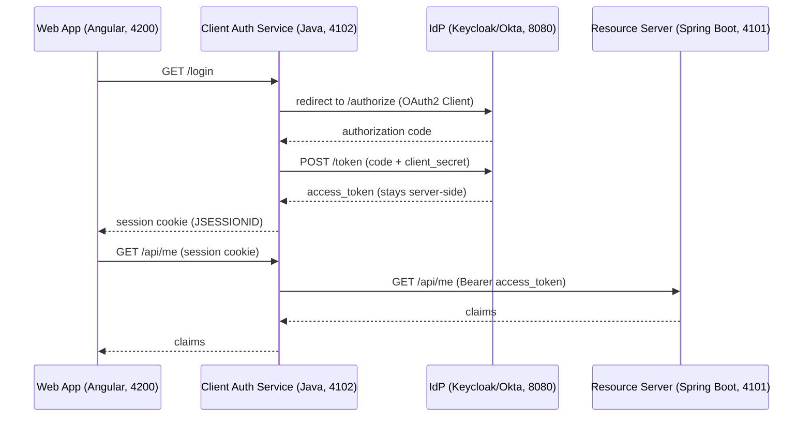
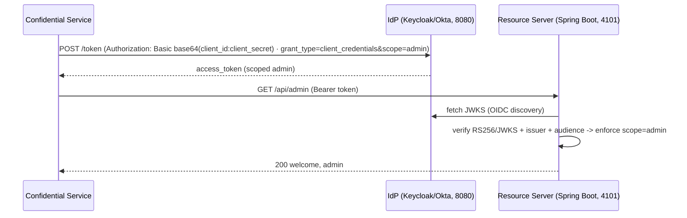

# Architecture — CIAM Prototype

## 1. Overview

A CIAM reference implementation with three clients: the **Web App** and **Mobile App**
sign in via OIDC **Authorization Code + PKCE**, and a **Confidential Service** uses
**Client Credentials**. A Spring Boot **Resource Server** validates RS256 JWTs (JWKS +
issuer + audience) and enforces scope/claim-based authorization. A **BFF** variant keeps
tokens server-side, and the reusable **Identity SDK** (plus a planned Spring Boot starter)
centralizes the validation logic.

## 2. Goals / Non-goals

**Goals**
- Demonstrate the OIDC/OAuth2 grant flows (PKCE, Client Credentials), JWT validation, and scoping.
- Provide a reusable, documented internal SDK + starter ("developer advocacy").
- Run locally end-to-end with no external accounts (Keycloak stand-in for Okta).
- Prove correctness with unit/integration tests (offline, no IdP required).

**Non-goals**
- Multi-tenancy.
- Production hardening beyond the reference implementation (TLS termination, secret-rotation automation, full observability pipeline).

## 3. Authentication flows

Three clients, each playing the **OAuth2 Client** role differently: the **Web App**
and **Mobile App** are *public* clients (direct **Authorization Code + PKCE** — the
standard, stateless flow); a **Java service** can be the *confidential* client
(**Authorization Code via BFF** — the **recommended hardened variant**, per ADR-006);
the **Confidential Service** is the *machine* client (**Client Credentials**).

### 3.1 Authorization Code + PKCE — Web App / Mobile App *(standard · implemented)*

### 3.2 Authorization Code via BFF — Java service as OAuth2 Client *(recommended for production · planned)*

### 3.3 Client Credentials — Confidential Service *(machine)*

C4 model (System Context → Container → Component): see `docs/C4.md`.

## 4. Components

- **Web App** (Angular) — `frontend/`. Authorization Code + PKCE via `oidc-client-ts`.
- **Mobile App** (React Native) — `mobile/` (planned). Same PKCE flow via Expo.
- **Confidential Service** (Java) — a machine client; Client Credentials via the SDK.
- **Client Auth Service (BFF)** (Java, planned) — `oauth2Login()`; session cookie; token server-side.
- **API Gateway** (planned) — edge routing, rate limiting, token validation.
- **Resource Server** (Spring Boot) — `resource-server/`. Spring Security OAuth2 filter
  chain: `/health` (public), `/api/me`, `/api/admin` (`SCOPE_admin`), `/api/claims`.
- **Identity SDK** (Java) — `identity-sdk-jvm/`. `Pkce`, `OidcDiscovery`, `ClientCredentials`,
  `ScopeAssertions` (+ planned Spring Boot starter, ADR-007).
- **IdP** — Keycloak locally (`ciam-demo` realm), Okta live.

## 5. Data model

| Entity | Fields |
|---|---|
| Access token (JWT) | `iss`, `aud`, `sub`, `exp`, `iat`, `scope`, `client_id`, `roles`/`groups` |
| Token response | `access_token`, `token_type`, `expires_in`, `scope` (optional `id_token`, `refresh_token`) |

## 6. Key decisions

See `docs/adr/`:
- `adr-001` — Authorization Code + PKCE and Client Credentials; RS256/JWKS validation.
- `adr-002` — JVM SDK in Java (Kotlin-interop).
- `adr-003` — React Native via Expo.
- `adr-004` — SAML 2.0 via Spring Security.
- `adr-005` — CI/CD and live-demo deployment.
- `adr-006` — direct PKCE vs. BFF.
- `adr-007` — RS validation: library vs. sidecar vs. central service.
- `adr-008` — secrets management: AWS Secrets Manager (prod) / host secrets (demo).

## 7. Honesty boundary

Project-level prototype, not production. Keycloak stands in for Okta. Backend is
Java (Spring Boot).

## 8. Roadmap

See `docs/ROADMAP.md` for the sequenced Now / Next / Later plan (Mobile App, SAML,
BFF, SDK starter, CI/CD, live demo).
