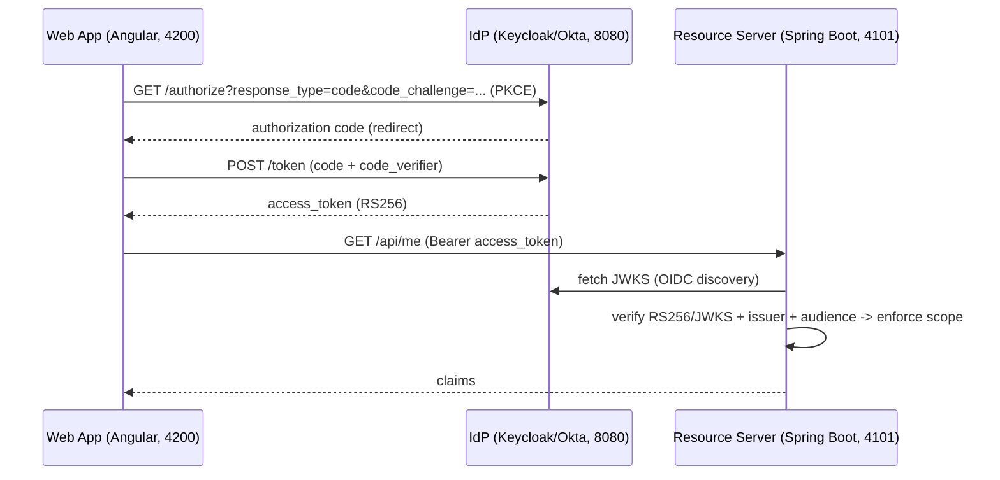
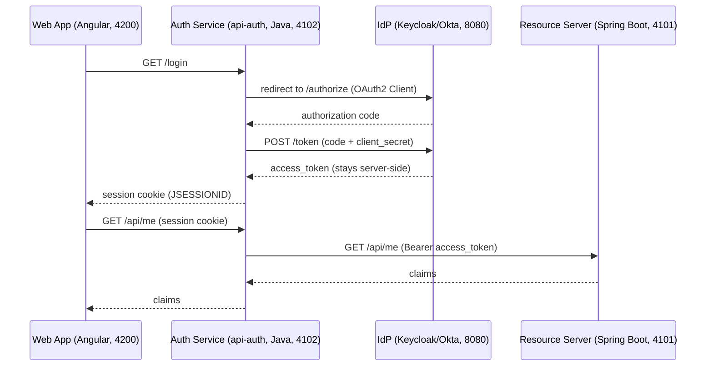
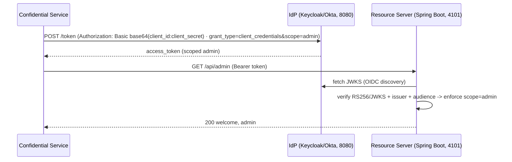

# Architecture — CIAM Prototype

## 1. Overview

A CIAM reference implementation across **four runtimes**. Three **clients** — the **Web App**
(Angular) and **Mobile App** (React Native) sign in via OIDC **Authorization Code + PKCE**, and a
**Confidential Service** uses **Client Credentials**. Two **resource servers** — **Java**
(`api-identity-jvm`, Spring Boot) and **Python** (`api-identity-python`, FastAPI) — validate the
same RS256 JWTs (JWKS + issuer + audience) and enforce the same scope/claim authorization. A
**BFF** variant keeps tokens server-side, and two reusable **Identity SDKs** — **Java**
(`sdk-identity-jvm`) and **Python** (`sdk-identity-python`) — centralize the client-side helpers
(discovery, PKCE, client-credentials, scope). Audiences are minted in the IdP (ADR-013).

## 2. Goals / Non-goals

**Goals**
- Demonstrate the OIDC/OAuth2 grant flows (PKCE, Client Credentials), JWT validation, and scoping.
- Provide a reusable, documented internal SDK + starter ("developer advocacy").
- Run locally end-to-end with no external accounts (Keycloak stand-in for Okta).
- Prove correctness with unit/integration tests (offline, no IdP required).

**Non-goals**
- Multi-tenancy.
- Production hardening beyond the reference implementation (TLS termination, secret-rotation automation, full observability pipeline).

## 3. Authentication flows

Three clients, each playing the **OAuth2 Client** role differently: the **Web App**
and **Mobile App** are *public* clients (direct **Authorization Code + PKCE** — the
standard, stateless flow); a **Java service** can be the *confidential* client
(**Authorization Code via BFF** — the **recommended hardened variant**, per ADR-006);
the **Confidential Service** is the *machine* client (**Client Credentials**).

### 3.1 Authorization Code + PKCE — Web App / Mobile App *(standard · implemented)*

> The same §3.1 flow targets either resource server — `api-identity-jvm` (Spring Boot, 4101) or
> `api-identity-python` (FastAPI, 4102) — with identical JWT validation (JWKS/RS256 + issuer +
> audience) and scope enforcement. Audiences are minted in the IdP (ADR-013).

### 3.2 Authorization Code via BFF — Java service as OAuth2 Client *(recommended for production · planned)*

### 3.3 Client Credentials — Confidential Service *(machine)*

C4 model (System Context → Container → Component): see `docs/C4.md`.

## 4. Components

- **Web App** (Angular) — `ui-identity/`. Authorization Code + PKCE via `oidc-client-ts`.
- **Mobile App** (React Native) — `mobile-identity/` (planned). Same PKCE flow via Expo.
- **Confidential Service** (Java) — a machine client; Client Credentials via the SDK.
- **Auth Service** (Java, planned) — `api-auth/`. `oauth2Login()`; session cookie; token server-side.
- **API Gateway** (planned) — edge routing, rate limiting, token validation.
- **Resource Server** (Spring Boot) — `api-identity-jvm/`. Spring
  Security OAuth2 filter chain: `/health` (public), `/api/me`, `/api/admin` (`SCOPE_admin`),
  `/api/claims`. Role: reference resource server (prototype) → identity data + IdP admin ops (target).
- **Identity SDK** (Java) — `sdk-identity-jvm/`. `Pkce`, `OidcDiscovery`, `ClientCredentials`,
  `ScopeAssertions` (+ planned Spring Boot starter, ADR-007).
- **IdP** — Keycloak locally (`ciam-demo` realm), Okta live.

## 5. Ownership model — platform vs product

CIAM splits cleanly into **platform** (the identity capability, owned centrally) and **product**
(each business domain, owned by its squad). Locked in [ADR-010](adr/adr-010-platform-vs-product.md).

| Concern | Owned by | Artifacts |
|---|---|---|
| **Platform — Identity/Auth squad** | central (one squad) | authentication process (login/session/token/refresh/MFA), IdP (Okta/Keycloak), `api-identity-jvm`, auth service (`api-auth`), `sdk-identity-jvm` (+ starter), auth standards, ADRs, threat model, risk register, secrets |
| **Product — domain squads** | each squad | its own `api-<domain>` / `ui-<domain>` / `mobile-<domain>` (+ any `bff-<domain>`) and domain data |

**Rules:**
- The **`identity` and `auth` domains are the platform's domains**; every other `-<domain>` is product-owned.
- The platform **builds safe defaults** (SDK + starter + this reference implementation); product
  squads **consume** them and *enforce* identity in their own services — they never re-own it
  (FR-6 developer advocacy).
- **Authentication = platform** (who you are + session + token issuance + verification library);
  **authorization = product** (what you can do in *their* domain), enforced via the platform SDK.

**Platform artifacts** (responsibility + state):

| Artifact | Provides | State |
|---|---|---|
| IdP (Okta/Keycloak) | identity store, credential verification, token issuance, MFA/consent | stateful |
| `api-auth` | the AuthN flow server-side — OIDC handshake → session cookie, token server-side | stateful (session) |
| `api-identity-jvm` | reference resource server (prototype) · identity data + IdP admin ops (target) | stateless (prototype) → stateful data slice (target) |
| `api-identity-python` | reference resource server (Python) — same endpoints + validation as `api-identity-jvm` | stateless |
| `sdk-identity-jvm` (+ starter) | safe defaults at build time for product services | — (compile-time) |
| `sdk-identity-python` | safe defaults at build time for Python product services | — (compile-time) |

- Product squads validate JWTs + scopes via `sdk-identity-jvm` / `sdk-identity-python` / the starter (ADR-007) — the same
  `verify-then-authorize` shape, with no central runtime hop.

**Library vs. service boundary:** validation + claims = **library** (`sdk-identity-jvm` + starter;
embedded, stateless, build-time — ADR-007). Shared identity **data** + privileged IdP **operations** =
**service** (`api-identity-jvm`; stateful, platform-owned, server-side secrets). A library holds no shared
state and no privileged secrets — so `api-identity-jvm`'s *service* role is the data/admin-ops slice, not
the validation (which the SDK already gives every service).

### RACI

| Artifact | Identity/Auth squad | Product squads | IdP (Okta/Keycloak) |
|---|---|---|---|
| IdP config | A | I | R |
| `api-identity-jvm` | R/A | C | — |
| `api-identity-python` | R/A | C | — |
| `api-auth` | R/A | C | — |
| `sdk-identity-jvm` | R/A | C (consumer) | — |
| `sdk-identity-python` | R/A | C (consumer) | — |
| Product `api-<domain>` | C (guardrails) | R/A | — |

R = responsible · A = accountable · C = consulted · I = informed.

## 6. Data model

| Entity | Fields |
|---|---|
| Access token (JWT) | `iss`, `aud`, `sub`, `exp`, `iat`, `scope`, `client_id`, `roles`/`groups` |
| Token response | `access_token`, `token_type`, `expires_in`, `scope` (optional `id_token`, `refresh_token`) |
| Identity profile (target) | `sub`, attributes, `consent` records, `mfa` enrollments, `entitlements` — the stateful slice of `api-identity-jvm` |
| Session (`api-auth`) | `session_id`, `sub`, `expires_at`, `idle_timeout` |
| OAuth client | `client_id`, `client_secret` ref (secrets manager), grant type, `redirect_uris` |

## 7. Key decisions

See `docs/adr/`:
- `adr-001` — Authorization Code + PKCE and Client Credentials; RS256/JWKS validation.
- `adr-002` — JVM SDK in Java (Kotlin-interop).
- `adr-003` — React Native via Expo.
- `adr-004` — SAML 2.0 via Spring Security.
- `adr-005` — CI/CD and live-demo deployment.
- `adr-006` — direct PKCE vs. BFF.
- `adr-007` — RS validation: library vs. sidecar vs. central service.
- `adr-008` — secrets management: AWS Secrets Manager (prod) / host secrets (demo).
- `adr-009` — component naming convention (`<layer>-<domain>`).
- `adr-010` — platform vs product ownership (team topology).
- `adr-011` — Python identity SDK + Python resource server (multi-runtime).
- `adr-012` — symmetric runtime suffixes (`api-identity-jvm`).
- `adr-013` — token audience strategy (Keycloak audience mappers).
- `adr-014` — multi-runtime parity (shared contract + fixtures).
- `adr-015` — strangler-fig migration with auto-PR adoption.
- `adr-016` — AWS deployment target (ECS Fargate + S3/CloudFront).
- `adr-017` — JFrog Artifactory for artifacts (enterprise).
- `adr-018` — CI/CD tool: GitHub Actions (demo) + Harness (enterprise).

## 8. Honesty boundary

Project-level prototype, not production. Keycloak stands in for Okta. Backends are
Java (Spring Boot) + Python (FastAPI).

## 9. Roadmap

See `docs/ROADMAP.md` for the sequenced Now / Next / Later plan (Mobile App, SAML,
BFF, SDK starter, CI/CD, live demo).
