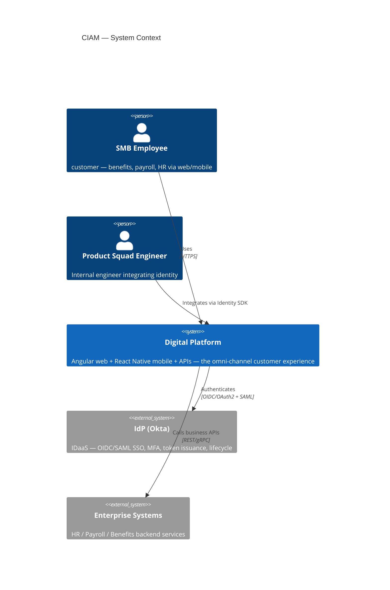
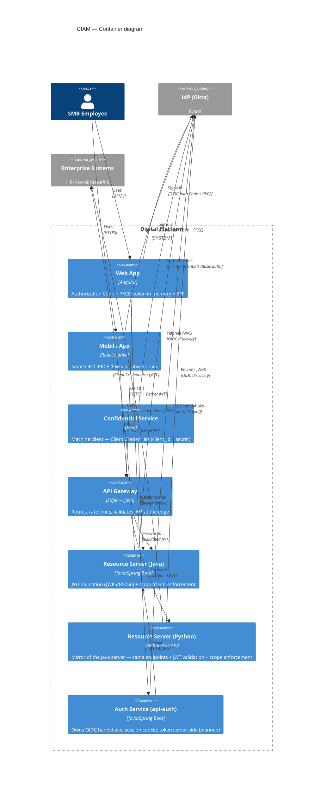
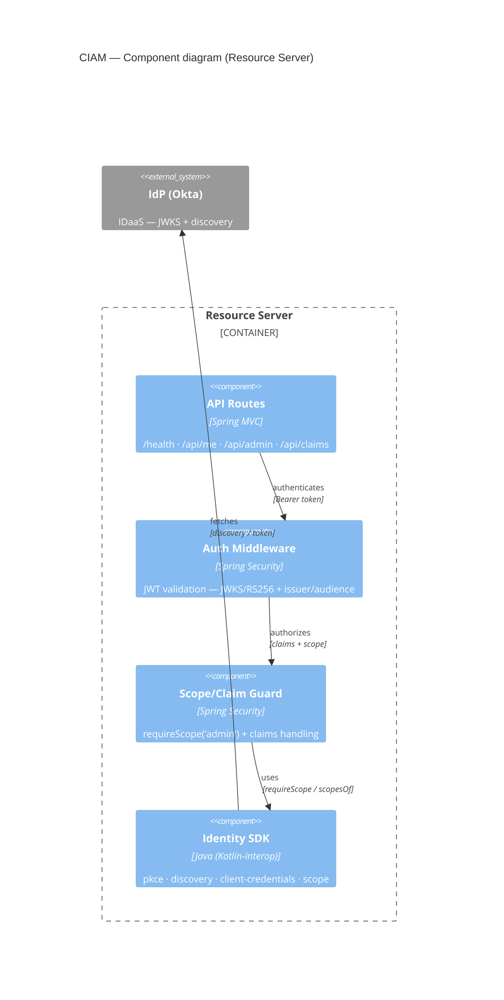

# C4 Model — CIAM Platform

> Reflects the **target** CIAM architecture (Angular web + React Native mobile +
> Okta + Java/Python SDKs + CI/CD). The `ciam-prototype` implements the Web App (Angular),
> Resource Servers (Java Spring Boot + Python FastAPI), Identity SDKs (Java + Python), and
> OIDC/OAuth2 flows; the Mobile App (React Native), API Gateway, SAML, and CI/CD pipeline are planned.
>
> Renders with **Mermaid ≥ 11** (native C4 diagrams).

## Level 1 — System Context

## Level 2 — Container

## Level 3 — Component (Resource Server)

> The Python resource server (`api-identity-python`) is a mirror of this component diagram:
> FastAPI routes (`/health` · `/api/me` · `/api/admin` · `/api/claims`), a `get_claims` dependency
> (JWKS/RS256 + issuer/audience), and `require_scope` from `sdk-identity-python`.

## Legend & notes

- **Level 4 (Code)** is intentionally omitted — too granular to be useful at Principal-review level; the class/interface detail lives in the `sdk-identity-jvm` source.
- **CI/CD** is a *supporting* concern, not a runtime container — it builds/tests/containerizes the above (see the planned GitHub Actions pipeline), which is why it isn't drawn at Levels 1–3.
- **Prototype vs. target:** implemented = Web App (Angular) + Resource Servers (Java Spring Boot + Python FastAPI) + Identity SDKs (Java + Python) + Keycloak (Okta stand-in). Planned = Mobile App (React Native), API Gateway, Auth Service (`api-auth`), SAML, CI/CD.
- **Auth Service (`api-auth`)** — the planned *hardened* variant: the Web App authenticates via the auth service (session cookie, token stays server-side) instead of PKCE directly. Both paths are shown; direct PKCE is the current default.
- **Ownership:** identity + auth are **platform** capabilities — the authentication process, IdP, `api-identity-jvm`, `api-identity-python`, the auth service (`api-auth`), and `sdk-identity-jvm`/`sdk-identity-python` — owned by the Identity/Auth squad; product squads own their domains (incl. any `bff-<domain>`) and consume identity (ADR-010).
